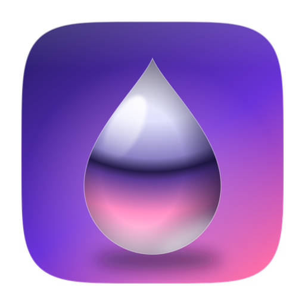

<p align="center"></p>
<h1 align="center">Gallium</h1>
<p align="center">A calm, Arc-style browser for Windows. Liquid Glass, Spaces and real photo wallpapers, built on Chromium (WebView2) with Tauri.</p>
<p align="center"><a href="https://idkiforgatit.github.io/gallium/">Website</a> · <a href="https://github.com/idkiforgatit/gallium/releases/latest">Download</a></p>

## Build

Needs Node.js, Rust and the WebView2 runtime (built into Windows 11).

```bash
npm install
npm run dev     # run in development
npm run build   # installer in src-tauri/target/release/bundle
```

Not affiliated with The Browser Company. Wallpapers from [Unsplash](https://unsplash.com).
